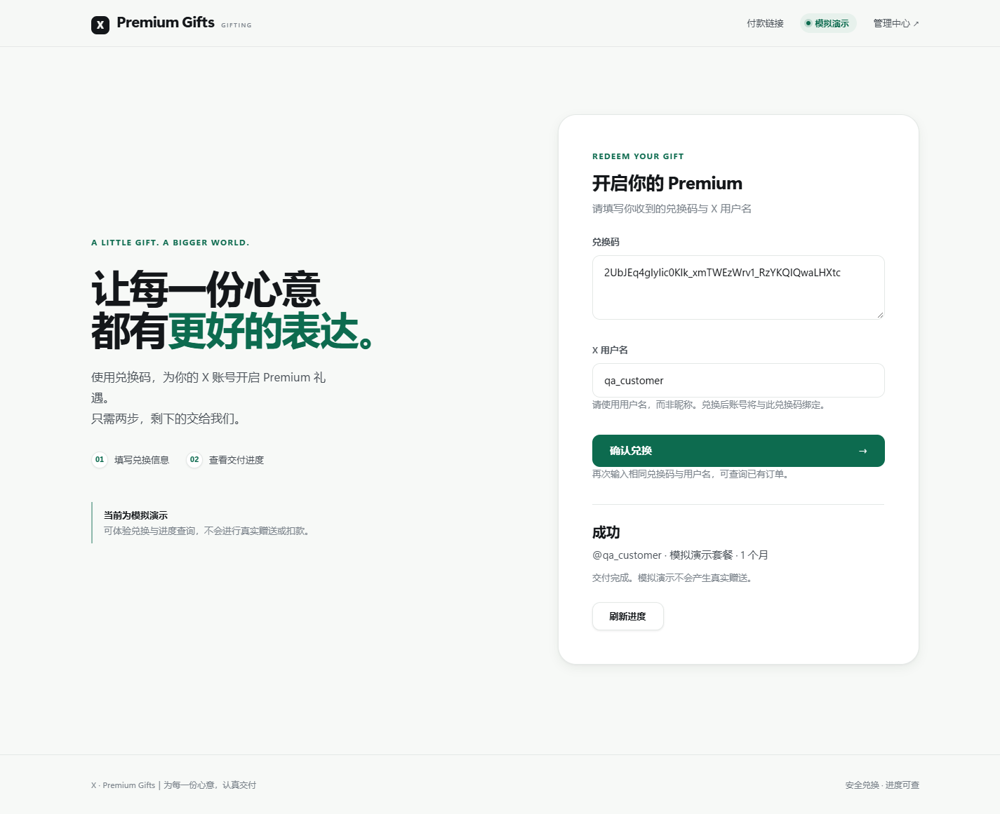
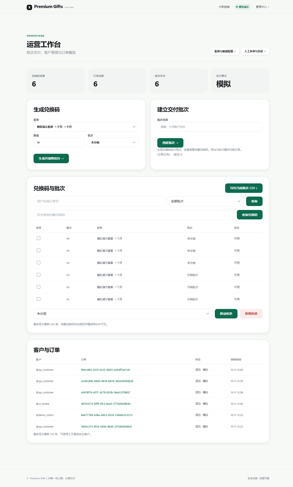

# X · Premium Gifts 零基础搭建教程（Windows）

> 这份教程假设你**从没写过代码**。只要你能复制、粘贴、按回车，就能把这个"X Premium 礼品兑换网站"在自己电脑或服务器上跑起来。
>
> 本地体验只需要一台 Windows 10 / 11 电脑。默认使用**模拟模式**：不连接 X、不连接支付、不花钱，可以完整走一遍“生成兑换码 → 客户兑换 → 系统交付”的流程。正式对外部署需要服务器和域名，见第 8、9 章；启用真实付款流程见第 14 章。

---

## 目录

1. [这套网站能做什么](#1-这套网站能做什么)
2. [准备清单](#2-准备清单)
3. [第一步：安装 uv（它会帮你装好 Python）](#3-第一步安装-uv)
4. [第二步：拿到项目文件](#4-第二步拿到项目文件)
5. [第三步：一条命令启动网站](#5-第三步一条命令启动网站)
6. [第四步：认识三个页面](#6-第四步认识三个页面)
7. [第五步：完整走一遍](#7-第五步完整走一遍)
8. [第六步：正式部署到公网（域名 + HTTPS）](#8-第六步正式部署到公网)
9. [第七步：让它变成开机自启的 Windows 服务](#9-第七步注册为-windows-服务)
10. [第八步：备份与恢复](#10-第八步备份与恢复)
11. [让网站看起来是你的（改颜色 / 改名字）](#11-让网站看起来是你的)
12. [常见问题 FAQ](#12-常见问题-faq)
13. [安全须知（重要）](#13-安全须知重要)
14. [启用并验收真实模式](#14-启用并验收真实模式)
15. [命令速查表](#15-命令速查表)

---

## 1. 这套网站能做什么

它主要由这几个页面组成：

| 页面 | 地址 | 谁来用 | 作用 |
| --- | --- | --- | --- |
| 兑换页 | `/` | 你的客户 | 输入兑换码 + X 用户名，查看交付进度 |
| 运营工作台 | `/operator/` | 你（运营） | 生成兑换码、建批次、导出 CSV、查询客户 |
| 管理后台 | `/admin/` | 你（管理员） | 配置套餐、加密保存敏感配置、查看订单 |
| 付款链接队列 | `/links/` | 你的客户 | 自助申请付款链接（模拟模式只生成示例链接） |
| 人工补单 | `/operator/recovery/` | 你（运营） | 处理异常订单，**先预览再执行**，不会重复扣款 |

客户看到的样子（兑换成功页）：



你看到的样子（运营工作台）：



一句话理解它的设计：**兑换码只用来"绑定客户"，真正的付款/赠送由后台 worker 一步一步慢慢做，任何"不确定"的情况都会停下来等人处理，绝不会自动重复扣钱。**

### 界面的几个特点（不需要你做任何事）

- **自动适配深色模式**。系统开深色，网站跟着变深色，不用配置。
- **手机、平板、电脑都好看**。窗口缩小会自动换成单列布局，导航也会自动精简。
- **键盘能操作**。按 `Tab` 键能看到当前焦点在哪，按 `Enter` 能提交。
- **开"降低动态效果"的人不会被动画晃到**。这是系统级无障碍设置，网站会自动服从。

如果你想把颜色、品牌名改成自己的，看第 11 章。

---

## 2. 准备清单

| 需要什么 | 说明 |
| --- | --- |
| Windows 10 / 11（64 位） | 服务器版 Windows Server 也可以 |
| 能上网 | 第一次安装依赖需要下载，约 100 MB |
| 管理员权限 | 仅"注册成服务"这一步需要，纯本地体验不需要 |
| 一个域名（可选） | 只在你打算让外网访问时才需要 |

**不需要**提前安装：Python、数据库、Node.js、Go，全都不用。`uv` 会一次性帮你准备好。

---

## 3. 第一步：安装 uv

`uv` 是一个"Python 环境管理器"，它负责安装 Python、下载项目依赖。我们只需要装这一个工具。

1. 按 `Win + X`，选择 **终端（管理员）** 或 **Windows PowerShell（管理员）**。
2. 复制下面这一行，粘贴进去，按回车：

```powershell
winget install --id astral-sh.uv -e
```

3. 看到 `已成功安装` 或 `Successfully installed` 就完成了。
4. **关掉这个窗口，重新打开一个新的 PowerShell**（让新命令生效）。
5. 验证一下，输入：

```powershell
uv --version
```

应该显示类似 `uv 0.12.16` 的版本号。

> 如果提示 `winget: 无法将"winget"项识别为 cmdlet`，说明系统太旧。可以先在"Microsoft Store"里搜索 **应用安装程序** 并更新，然后重试。

> Windows Server 上可能没有 Microsoft Store 或 winget。此时按 [uv 官方安装说明](https://docs.astral.sh/uv/getting-started/installation/)使用 Windows 独立安装器；装完重新打开 PowerShell，再运行 `uv --version`。

---

## 4. 第二步：拿到项目文件

### 方式 A：从 GitHub 下载（推荐）

1. 打开[小白部署教程系列仓库](https://github.com/libiucode/beginner-deployment-guides)，点绿色的 **Code** → **Download ZIP**。
2. 解压 ZIP，找到里面的 `projects\xgift-python` 文件夹。把**整个 `xgift-python` 文件夹**复制到一个路径简单、没有中文的位置，例如：

   ```
   C:\X\xgift-python
   ```

   > 确认最后是 `C:\X\xgift-python\manage.py`，而不是多套一层文件夹。路径里可以有空格，但请避免中文和特殊符号，能省掉很多麻烦。

### 方式 B：用 git 克隆（你已装 git 的话）

```powershell
New-Item -ItemType Directory -Force C:\X | Out-Null
git clone https://github.com/libiucode/beginner-deployment-guides.git C:\X\beginner-deployment-guides
Copy-Item -LiteralPath C:\X\beginner-deployment-guides\projects\xgift-python -Destination C:\X\xgift-python -Recurse
```

### 方式 C：复制你已经拿到的项目文件夹

如果这份 `xgift-python` 是别人直接交给你的文件夹，可以把**整个项目文件夹**复制到 `C:\X\xgift-python`；部署到服务器时也可以通过远程桌面的文件复制功能传过去。确认 `manage.py`、`pyproject.toml`、`uv.lock`、`deploy`、`gift` 都在。不要把本机的 `private`、`db.sqlite3`、`.venv` 一起当作正式服务器配置；按第 8 章在服务器上新建配置并安装依赖。

### 打开"正确的文件夹"

解压后，文件夹里应该能看到 `manage.py`、`pyproject.toml`、`config`、`gift`、`deploy` 这些文件。

在文件资源管理器里进入这个文件夹，然后**在地址栏输入 `powershell` 并按回车**（或按住 `Shift` 右键空白处 → "在此处打开 PowerShell 窗口"）。这样打开的命令行就已经在正确目录了。

用下面命令确认一下当前位置：

```powershell
Get-Location
```

---

## 5. 第三步：一条命令启动网站

在刚才的 PowerShell 窗口里，粘贴并回车：

```powershell
powershell -ExecutionPolicy Bypass -File .\deploy\quickstart.ps1
```

> **常用可选参数**：
> - `-Port 8080` —— 换端口（默认 8000）。如果 8000 已被占用（比如装了 Docker），一定要加这个。
> - `-Codes 20` —— 一次生成多少个演示兑换码（默认 5）。
> - `-NoWindows` —— 不自动开两个窗口，只把该做的准备做完。
>
> 例如：`powershell -ExecutionPolicy Bypass -File .\deploy\quickstart.ps1 -Port 8080 -Codes 20`

接下来会发生什么：

1. 自动安装依赖（首次约 3~10 分钟，屏幕会滚动很多文字，**这是正常的**）。
2. 初始化数据库。
3. 提示你**输入管理员密码**：
   ```
   初始管理员密码：
   ```
   **输入时屏幕上不会显示任何字符**（这是安全设计，不是卡住了），输完按回车。密码建议 12 位以上、包含大小写和符号。
4. 自动创建演示套餐和 5 个模拟兑换码，并把兑换码打印在屏幕上。
5. 自动弹出**两个新窗口**：一个是网站，一个是 worker（后台处理订单的进程）。

最后屏幕上会显示：

```
本机体验地址：
  兑换页面   http://127.0.0.1:8000/
  运营工作台 http://127.0.0.1:8000/operator/
  管理后台   http://127.0.0.1:8000/admin/
```

把 `http://127.0.0.1:8000/` 复制到浏览器打开，就能看到网站了 🎉

> **关于那两个黑窗口**：一个都不能关。
> - `serve_xgift` 是网站本身，关了网站就打不开。
> - `run_worker` 是后台工人，关了订单就会一直停在"排队"。
>
> 想停止网站：**在这两个窗口里分别按 `Ctrl + C`**（按一次没反应就再按一次，它会等当前操作做完再退出）。

### 不想自动开窗口？手动启动也可以

```powershell
# 终端 1：网站
.venv\Scripts\python.exe manage.py serve_xgift

# 终端 2：worker
.venv\Scripts\python.exe manage.py run_worker
```

### 完整的手动命令（万一脚本报错，照这个一步步来）

```powershell
uv sync --locked                                                  # 安装依赖
.venv\Scripts\python.exe manage.py migrate                        # 建数据库
.venv\Scripts\python.exe manage.py setup_xgift                    # 建管理员（会问密码）
.venv\Scripts\python.exe manage.py demo_setup --count 5           # 建演示数据+兑换码
.venv\Scripts\python.exe manage.py collectstatic --noinput        # 整理网页样式文件
.venv\Scripts\python.exe manage.py serve_xgift                    # 启动网站
```

---

## 6. 第四步：认识三个页面

### ① 兑换页 `/`（给客户看）

客户在这里粘贴兑换码、填写 X 用户名，就能看到交付进度。模拟模式下会显示"当前为模拟演示"的提示。

### ② 运营工作台 `/operator/`（你日常最常用）

第一次打开会跳到登录页，用刚才设置的管理员账号密码登录。登录后你能：

- **建立交付批次**：给一批兑换码起个名字（例如"十月客户交付"）。
- **生成兑换码**：选套餐 + 数量，点"生成并加密保存"。生成后兑换码会被加密存进数据库。
- **导出当前批次 CSV**：这是你**唯一**能看到完整兑换码的方式，导出的文件请立刻安全保存。
- **安全查询完整兑换码**：输入一个完整兑换码反查它属于哪个批次。
- **停用所选**：作废一批兑换码。
- **客户与订单**：看谁兑换了什么、状态如何。
- **人工补单与历史**：处理异常订单（有 `gift.change_order` 权限才显示）。

### ③ 管理后台 `/admin/`（配置中心）

- **套餐 Plan**：定义"1 个月 / 12 个月"这样的商品。模拟模式下商户和产品编号随便填。
- **加密配置 Secret**：只对超级管理员可见，用来保存 X 会话、支付密钥、代理等敏感信息。**保存后不会再显示明文**，只能覆盖。
- **订单 / 兑换码 / 审计记录**：只读查看，删除被禁用（防止误删）。

**重要**：
- 兑换码的完整明文**只会**在"导出 CSV"或"授权查看详情"时出现，列表页永远只显示编号。
- 后台每次查看完整兑换码、导出 CSV、生成兑换码，都会写入审计记录。

---

## 7. 第五步：完整走一遍

下面这条路线适合打完收工式地"验收"一遍，全程不花钱。

**准备**：确认两个黑窗口都在运行；从启动日志里复制一个兑换码。

1. 浏览器打开 `http://127.0.0.1:8000/`。
2. 在"兑换码"框里粘贴兑换码。
3. "X 用户名"随便填一个合法用户名，例如 `qa_customer`（只能用字母、数字、下划线，最长 15 位）。
4. 点"确认兑换"。
5. 页面会显示"排队 / 核验中 / 成功"。**如果一直停在"排队"**，说明 worker 窗口没在跑，去检查第二个窗口。
6. 切换到你运营工作台的窗口，点"刷新"就能看到订单状态变成"成功"。

> 想看更完整的效果，可以再点顶部导航的 **付款链接**，走一遍 `/links/` 的自助申请流程。模拟模式只会生成一个示例链接，**不能真的付款**。

**怎么知道系统在正常工作？**

```powershell
.venv\Scripts\python.exe -m pytest -q
```

应看到测试全部通过、失败数为 0。通过的数量会随项目版本变化；这是项目自带的自动化测试，能检查核心逻辑，但不能代替公网和真实付款验收。

---

## 8. 第六步：正式部署到公网

> 只有你打算让**外网客户访问**时才需要看这一章。纯本地体验完成第 7 章就可以停下。这里的“正式部署”指网站可通过公网 HTTPS 持续访问；系统仍保持 `simulated` 模式，真实付款另见第 14 章。

### 8.0 先确认部署条件

推荐一台有**固定公网 IP** 的 Windows Server 云服务器。你还需要一个可管理 DNS 记录的域名、服务器管理员权限，以及能从外网访问的 TCP **80、443** 端口。云服务器通常同时有“安全组”和 Windows 防火墙，两处都要放行 80、443；**8000 不对公网开放**。

如果用家里的 Windows 电脑，还需确认运营商提供可入站访问的公网 IP，并在路由器上把 80、443 转发到这台电脑。处于运营商共享地址（CGNAT）、无法做端口转发或 IP 经常变化时，下面的域名直连方法不能照搬。先用云服务器完成首次正式部署会更省事。

以下命令都在**服务器上的项目根目录**执行。先按第 3、4 章安装 uv、下载项目，再运行：

```powershell
uv sync --locked
```

不要在这台正式服务器上运行 `quickstart.ps1`：它会建立模拟演示套餐和兑换码。部署前先决定实际使用的域名，例如 `gift.example.com`；下文出现这个示例域名的地方都要换成你自己的。

### 8.1 创建生产配置文件

在项目目录里执行：

```powershell
New-Item -ItemType Directory -Force private | Out-Null
Copy-Item -LiteralPath .env.example -Destination private\server.env
```

准备数据目录（示例中数据库和主密钥都放在这里）：

```powershell
New-Item -ItemType Directory -Force 'C:\X data' | Out-Null
```

然后用记事本打开 `private\server.env`（**右键 → 打开方式 → 记事本**），改成你自己的信息：

```ini
XGIFT_MODE=simulated
DJANGO_DEBUG=false

# 换成你的域名
DJANGO_ALLOWED_HOSTS=gift.example.com
DJANGO_CSRF_TRUSTED_ORIGINS=https://gift.example.com
DJANGO_HTTPS=true
XGIFT_TRUST_CADDY=true

# 把数据放到项目之外的专用目录，避免升级时被覆盖
XGIFT_DATABASE="C:/X data/db.sqlite3"
XGIFT_KEY_FILE="C:/X data/master.key"

# 强烈建议单独设置，随便打一长串随机字符即可
DJANGO_SECRET_KEY=换成你自己的一长串随机字符至少50位
```

**格式要求**（很容易踩坑）：
- 一行一个 `名称=值`。
- 路径含空格时用**双引号**包起来。
- 不支持行尾注释（`#` 只能单独成行）。
- 布尔值只写 `true` / `false` / `1` / `0`。
- 文件保存为 **UTF-8** 编码。

### 8.2 用这份配置初始化

每次开新终端都要先设置这一句，告诉程序"用哪份配置"：

```powershell
$env:XGIFT_ENV_FILE = (Resolve-Path -LiteralPath private\server.env).Path
```

然后：

```powershell
.venv\Scripts\python.exe manage.py migrate
.venv\Scripts\python.exe manage.py setup_xgift
.venv\Scripts\python.exe manage.py collectstatic --noinput
.venv\Scripts\python.exe manage.py check --deploy
```

最后一条如果输出 `System check identified no issues`，说明 Django 的部署检查通过。域名、证书和公网连通性还要在第 9 章实际验收。

> ⚠️ **注意**：换了数据库路径，就等于换了一个"新站"，本机模拟时生成的兑换码不会带过来。这是正常的，别慌。

### 8.3 安装 Caddy 提供 HTTPS

网站本身只监听 `127.0.0.1:8000`，不直接对外。外部访问统一走 **Caddy**，它会自动申请并续期免费 HTTPS 证书。

1. 下载 Caddy for Windows：<https://caddyserver.com/download>
2. 把 `caddy.exe` 放到 `C:\Caddy\caddy.exe`。
3. 把项目里的 `deploy\Caddyfile` 复制到 `C:\Caddy\Caddyfile`，改第一行的域名为你的真实域名：

   ```caddyfile
   gift.example.com {
       reverse_proxy 127.0.0.1:8000 {
           header_up X-XGift-Client-IP {remote_host}
           header_up X-Forwarded-Proto {scheme}
       }
   }
   ```

4. 到你的域名服务商那里，把 `gift.example.com` 的 **A 记录**指向服务器的公网 IPv4 地址。如果还有 AAAA 记录，它也必须指向可访问的服务器 IPv6 地址；没有 IPv6 就不要保留错误的 AAAA 记录。等 DNS 生效后，在服务器上检查：

   ```powershell
   Resolve-DnsName gift.example.com
   ```

5. 在云平台安全组中放行入站 TCP 80、443。然后在**管理员 PowerShell** 中放行 Windows 防火墙：

   ```powershell
   New-NetFirewallRule -DisplayName 'XGift HTTPS' -Direction Inbound -Action Allow -Protocol TCP -LocalPort 443
   New-NetFirewallRule -DisplayName 'XGift HTTP for certificate' -Direction Inbound -Action Allow -Protocol TCP -LocalPort 80
   ```

   如果已有等效规则，不必重复创建。检查云平台和 Windows 防火墙都没有放行公网入站 8000。

6. 检查 Caddyfile 的语法：

   ```powershell
   cd C:\Caddy
   .\caddy.exe validate --config C:\Caddy\Caddyfile
   ```

   语法检查通过后，继续第 9 章启动三个服务。Caddy 首次启动时会自动申请证书；公网访问也在三个服务启动后一起验收。

> ⚠️ **HSTS 提醒**：生产配置会告诉浏览器"以后只用 HTTPS 访问这个站"。**请先确认你的域名（以及所有子域名）都能正常 HTTPS**，再正式上线，否则会把自己锁在门外。

---

## 9. 第七步：注册为 Windows 服务

**这一步必须用"管理员"身份打开 PowerShell。** 本节会让网站、worker 和 Caddy 都开机启动。

前置条件（缺一不可）：
- `private\server.env` 已经按要求写好，且数据库/密钥指向**专用目录**（例如 `C:\X data`）。
- 已经用这份配置跑过 `migrate` / `setup_xgift` / `collectstatic`。

先回到项目根目录（如果你沿用了第 4 章的示例路径，命令如下；否则换成自己的项目路径），再依次执行：

```powershell
Set-Location 'C:\X\xgift-python'
powershell -ExecutionPolicy Bypass -File .\deploy\install.ps1
powershell -ExecutionPolicy Bypass -File .\deploy\start.ps1
```

以后需要维护或备份时，才运行 `powershell -ExecutionPolicy Bypass -File .\deploy\stop.ps1` 停止网站和 worker；它不会停止 Caddy。

查看状态：

```powershell
Get-Service XGiftWeb, XGiftWorker
```

### 让 Caddy 也开机启动

在**管理员 PowerShell** 中注册并启动 Caddy（服务方式参考 [Caddy 官方文档](https://caddyserver.com/docs/running#windows-service)）：

```powershell
sc.exe create Caddy start= auto binPath= 'C:\Caddy\caddy.exe run --config C:\Caddy\Caddyfile'
Start-Service Caddy
Get-Service Caddy, XGiftWeb, XGiftWorker
```

三项状态都应是 `Running`。这里通过绝对路径指定 Caddyfile，避免服务启动时工作目录不同导致找不到配置。今后修改 Caddyfile，可先运行 `C:\Caddy\caddy.exe validate --config C:\Caddy\Caddyfile`，再运行 `C:\Caddy\caddy.exe reload --config C:\Caddy\Caddyfile`。Caddy 的证书和状态数据默认保存在运行该服务的账户目录中；不要随意更换服务账户或删除该目录。

最后做一次**真正的上线验收**：用手机流量（关闭 Wi-Fi）访问 HTTPS 地址，确认页面和静态样式正常，再查看 `/operator/` 是否出现登录页。若 Caddy 证书申请失败，先检查域名解析和外网到 80、443 的连通性。然后在服务器上重启一次，再确认 `Get-Service Caddy, XGiftWeb, XGiftWorker` 都是 `Running`，并再次用手机流量访问。只在服务器本机打开 `127.0.0.1:8000`，不能证明公网部署成功。

**这个脚本做了什么？**
- 把 `private` 目录、数据目录、密钥文件的访问权限收紧，只给服务账户、SYSTEM 和管理员。
- 注册两个服务：`XGiftWeb`（网站）和 `XGiftWorker`（后台工人），使用权限较小的 `NT AUTHORITY\LocalService` 账户。Caddy 服务由上面的独立命令注册。
- **不会**修改防火墙、不会启动服务（启动要你手动执行 `start.ps1`）。

**关于停止**：`stop.ps1` 是**优雅停止**——它会等当前正在处理的订单做完再退出。所以可能等几秒到几十秒，**千万不要用任务管理器强杀**，否则可能留下"待核实"订单。

> 想换成专用服务账户？在 `services.msc` 里改网站和 worker 两个服务的“登录”身份，并单独授予数据目录读写权限。**不要把密码写在命令行里。**

---

## 10. 第八步：备份与恢复

### 备份

**先停止两个服务**，然后：

```powershell
powershell -ExecutionPolicy Bypass -File .\deploy\stop.ps1
powershell -ExecutionPolicy Bypass -File .\deploy\backup.ps1 -Destination 'D:\X backup\2026-10-11'
powershell -ExecutionPolicy Bypass -File .\deploy\start.ps1
```

备份目录里会有两个东西，**它们必须成对保存**：

- `db.sqlite3`：数据库快照
- `master.key`：主密钥（没有它，数据库里的兑换码全部解不开）

> `master.key` 等于你所有数据的钥匙。**不要上传到网盘、GitHub、聊天软件**。要单独离线加密保存。
>
> 同样地，`private\server.env` 里的 `DJANGO_SECRET_KEY` 也要单独备份。

### 恢复

```powershell
powershell -ExecutionPolicy Bypass -File .\deploy\stop.ps1
powershell -ExecutionPolicy Bypass -File .\deploy\restore.ps1 -Source 'D:\X backup\2026-10-11'
powershell -ExecutionPolicy Bypass -File .\deploy\start.ps1
```

恢复脚本会：
1. 检查你确实停了服务；
2. 校验备份的主密钥是 32 字节、数据库完整；
3. 把**现有的**数据库/密钥改名为 `xxx.replaced-时间戳` 保留（不删除，可回滚）；
4. 复制备份进去；
5. 自动运行一次 `manage.py check` 自检。

> **绝对不要**因为"忘了密码"就去删密钥或删数据库重新初始化——那会让所有兑换码永久无法解密。忘记密码时，用另一个管理员账号在 `/admin/` 里改，或重新注册一个管理员用户名。

---

## 11. 让网站看起来是你的

网站名叫 **X · Premium Gifts**，配色是一套深绿色。想改成自己的？只需要改一个文件和一个模板，**不用懂 CSS**。所有修改都可以用**记事本**完成。

### 11.1 改颜色（只改 3 行）

用记事本打开 `gift\static\gift\site.css`，**开头部分**能找到这几行：

```css
--ink: #14171a;      /* 正文颜色（接近黑） */
--paper: #f7f9f7;    /* 页面底色 */
--accent: #0d6b4f;   /* 强调色：按钮、链接、高亮 */
```

把 `--accent` 改成你想要的品牌色即可，其他颜色会自动配合。例如改成蓝色：

```css
--accent: #0b63c5;
```

> ⚠️ **必须改两处**。深色模式下面还有一段 `@media (prefers-color-scheme: dark)`，里面的 `--accent` 也要一起改（深色模式需要更亮一点的颜色，否则会刺眼）：
>
> ```css
> --accent: #3fbd8f;   /* 改成你品牌色的"亮版" */
> --on-accent: #06231a;  /* 按钮上的文字颜色 */
> ```

改完执行一次，让浏览器拿到新样式：

```powershell
.venv\Scripts\python.exe manage.py collectstatic --noinput
```

然后在浏览器里按 **Ctrl + F5** 强制刷新。

### 11.2 怎么挑一个"好看"的颜色

三个不需要审美的规矩：

1. **深色比亮色更安全**。像 `#0d6b4f`、`#1a4d8f`、`#7a3b2e` 这种中等深度的颜色，白字压在上面看得清。
2. **不要在按钮上用亮黄、亮青、亮粉**。白字压上去基本看不清（这是网上很多网站的通病）。
3. **不确定就用在线工具验一下**。搜"对比度检测器 / contrast checker"，把两个颜色填进去，**正文要到 4.5 才算合格**。

### 11.3 改品牌名

用记事本打开 `gift\templates\gift\base.html`，找到页头部分：

```html
<a class="brand" href="/">
<span class="mark" aria-hidden="true">X</span>
<span>Premium Gifts</span>
<small>Gifting</small>
</a>
```

- `<span class="mark">` 里的 **X**：左上角那个方块里的字，建议只写 1~2 个字符。
- `<span>Premium Gifts</span>`：品牌名主文字。
- `<small>Gifting</small>`：右边的小标签，手机上会自动隐藏；不想要可以整行删掉。

同一文件里还有这几处文案，按需替换：

```html
<title>X · Premium Gifts</title>
```

```html
<span>X · Premium Gifts｜为每一份心意，认真交付</span>
<span>安全兑换 · 进度可查</span>
```

改完刷新浏览器即可，**模板不需要 `collectstatic`**。

### 11.4 改浏览器标签图标与其他细节

还是在 `base.html` 里，找到 `<link rel="icon" ...>` 那一行。它现在是一段写死的 SVG（一个深色方块加白色 X）。

最省事的做法：把自己的图片命名为 `favicon.ico`，放到 `gift\static\gift\` 目录，然后把那一整行换成：

```html
<link rel="icon" href="/static/gift/favicon.ico">
```

再执行一次 `collectstatic`。

顺便注意上面两行 `theme-color`：手机上浏览器的地址栏颜色就是它们。改了底色的话，这里也一起改：

```html
<meta name="theme-color" content="#f7f9f7" media="(prefers-color-scheme: light)">
<meta name="theme-color" content="#0c0e0d" media="(prefers-color-scheme: dark)">
```

### 11.5 想改版式、加页面？

那就不只是改颜色了，建议直接找懂前端的人，或让 AI 助手帮你改。可以参考项目里已经做好的设计规范：

| 文件 | 内容 |
| --- | --- |
| `gift\static\gift\site.css` | 所有颜色/字号/间距/圆角的"开关"都集中在文件最上方 |
| `gift\templates\gift\*.html` | 四个页面的结构 |
| `gift\static\gift\public.js` | 兑换页的交互与状态文案 |

**改坏了怎么办？** 用 Git 一键还原（前提是你没删 `.git` 目录）：

```powershell
git checkout -- gift/static/gift/site.css gift/templates/gift/base.html
```

或者从 GitHub 重新下载一份 ZIP，只把这两个文件拷回来覆盖。

---

## 12. 常见问题 FAQ

**Q：PowerShell 提示"禁止运行脚本 / cannot be loaded because running scripts is disabled"？**
A：用这条命令运行脚本即可（不用改系统设置）：
```powershell
powershell -ExecutionPolicy Bypass -File .\deploy\quickstart.ps1
```

**Q：提示 `uv : 无法将"uv"项识别为 cmdlet`？**
A：装完 uv 后**必须重新打开一个新的 PowerShell 窗口**。还不行就重启电脑。

**Q：8000 端口被占用 / 网站起不来？**
A：先确认是不是别的程序占着：
```powershell
Get-NetTCPConnection -LocalPort 8000 -State Listen | Select-Object OwningProcess
```
换个端口启动即可：
```powershell
.venv\Scripts\python.exe manage.py serve_xgift --port 8080
```
或者让一键脚本直接换端口：
```powershell
powershell -ExecutionPolicy Bypass -File .\deploy\quickstart.ps1 -Port 8080
```

**Q：网站打开了，但样式全乱、按钮很难看？**
A：忘了执行 `collectstatic`。执行一次：
```powershell
.venv\Scripts\python.exe manage.py collectstatic --noinput
```
然后重启网站。

**Q：兑换后一直停在"排队"？**
A：worker 没在运行。去运行：
```powershell
.venv\Scripts\python.exe manage.py run_worker
```

**Q：忘记管理员密码了？**
A：用另一个超级管理员账号登录 `/admin/` 修改；或新建一个管理员用户名：
```powershell
.venv\Scripts\python.exe manage.py setup_xgift --username admin2
```

**Q：我想把演示数据清空重来？**
A：以下只适用于第 5 章使用默认 `db.sqlite3` 的**本地模拟体验**，不能用于第 8 章的正式数据。先关掉网站和 worker 两个窗口，确认仍是模拟模式，再在项目根目录执行：
```powershell
Rename-Item -LiteralPath .\db.sqlite3 -NewName ("db.sqlite3.demo-" + (Get-Date -Format 'yyyyMMdd-HHmmss'))
.venv\Scripts\python.exe manage.py migrate
.venv\Scripts\python.exe manage.py setup_xgift
.venv\Scripts\python.exe manage.py demo_setup --count 5
```
原数据库已改名保留；主密钥不要删除。完成后按第 5 章重新启动网站和 worker。

**Q：兑换码在哪里导出？**
A：`/operator/` 页面右上角"导出当前批次 CSV ↓"，需要 `gift.export_code` 权限（超级管理员默认有）。导出的 CSV 用 Excel 打开时请用 UTF-8。

**Q：改了颜色/品牌名，但浏览器里没变？**
A：三件事按顺序查：
1. 改了 `.css` 必须先跑一次 `collectstatic`；只改 `.html` 则不用。
2. 按 **Ctrl + F5** 强制刷新（普通刷新会用缓存）。
3. 确认改的是 **两处** `--accent`：浅色一处，深色模式那段 `@media` 里还有一处。

**Q：屏幕中文变成乱码？**
A：执行前先设置：
```powershell
$env:PYTHONUTF8 = '1'
```

**Q：切换成真实模式后，worker 报错说配置不完整？**
A：真实模式必须先在 `/admin/` 里保存有效的 `x-auth` 和 `stripe-key`。`proxy` 可选；需要指定 X 区域出口或支付出口时才添加。配置缺失或格式不对时 worker 会拒绝工作，不会自动按模拟成功处理。按第 14 章逐项检查。

**Q：客户投诉"我付款了但没到账"？**
A：**不要点重试**。让客户在 `/links/` 点"我已付款，核实原会话"，或你在后台用：
```powershell
.venv\Scripts\python.exe manage.py reconcile_order <订单UUID>
```
它只**查询**原订单，绝不重新付款。

---

## 13. 安全须知（重要）

请认真读完这几条，它们能救你一整个季度的业务：

1. **主密钥就是命根子**。`master.key` 丢失 → 所有兑换码永久无法解密。备份时数据库和密钥必须成对。
2. **兑换码明文只存在于导出文件里**。导出后马上转移到安全位置，别留在下载文件夹。
3. **不要把网站直接暴露在公网端口**。只让 Caddy 访问 `127.0.0.1:8000`，不要开放 8000 端口。
4. **不要在前面加 CDN 或其他代理**。限流依赖 Caddy 传入的真实 IP，多一层代理会让限流失效。
5. **不要往配置里塞卡号/CVC**。程序会主动拒绝包含卡信息的配置；卡号只在服务器本机交互式输入，用完即丢。
6. **遇到"待核实"就停下来查**，不要重复下单、不要重复付款。系统故意设计成"宁可慢，不错付"。
7. **定期备份，并且定期演练恢复**。没演练过的备份不算备份。
8. **升级前先备份**，升级后跑一遍 `pytest -q` 和 `manage.py check`。

---

## 14. 启用并验收真实模式

本章从已完成第 8、9 章的公网部署开始。**真实模式会调用 X 和支付接口，创建真实付款链接；只有管理员在服务器本机逐单授权，程序才会提交卡付款。** 目前项目的真实接口只有本地模拟响应测试，没有使用真实账户和真实扣款完成端到端验收。X 接口属于非公开接口快照，可能随上游改变。请先用一个明确的测试订单和可承受的金额完成验收，再决定是否开放给客户。

### 14.1 准备真实配置

先准备你有权使用的 X 登录会话、有效的 Stripe **发布密钥**（以 `pk_live_` 开头）、真实套餐信息、指定的测试 X 用户和付款方式。付款前要能核对商户、币种、金额和月份。`/admin/` 中的“加密配置”只允许超级管理员填写；保存后不会再显示原文。**不要把卡号或 CVC 写入这里、配置文件、聊天消息或命令行。**

在仍为 `simulated` 模式时，登录 `/admin/` → **加密配置**，分别新增：

| 配置类型 | “新配置值”应填什么 |
| --- | --- |
| `x-auth` | JSON 对象，恰好包含 `auth_token`、`ct0`、`authorization`、`user_agent` 四个非空字符串；`authorization` 必须以 `Bearer ` 开头 |
| `stripe-key` | 有效的 `pk_live_...` 发布密钥，不是 Stripe 私钥 |
| `proxy`（可选） | JSON 对象；可含 `x_region` 代理地址和 `payment_outbounds` 出口列表。无需代理时可不创建此项，程序会走直连 |

`x-auth` 的 JSON 结构如下。四个占位值必须替换成你自己有权使用的有效会话信息；这里的示例不能直接运行：

```json
{"auth_token":"你的 auth_token","ct0":"你的 ct0","authorization":"Bearer 你的授权值","user_agent":"你的浏览器 User-Agent"}
```

`proxy` 的格式示意如下。这里的地址只是格式示例，不能直接用于真实订单；HTTP、HTTPS、SOCKS5、SOCKS5H 均受支持。出口名称在同一列表中不能重复；直连出口的 `url` 必须是 `null`。

```json
{"x_region":"socks5h://127.0.0.1:1080","payment_outbounds":[{"name":"primary","url":"http://127.0.0.1:8080"},{"name":"direct","url":null}]}
```

在 `/admin/` → **套餐 Plan** 创建或核对真实套餐：`merchant` 应是 `acct_...`，`product_id` 应是 `prod_...`；币种用三个大写字母，金额填**最小货币单位**（例如 9.99 USD 填 `999`），月份和远端实际商品一致。模拟演示套餐的 `simulated-merchant`、`simulated-premium` 不能用于真实订单。确认真实套餐启用，并停用不准备对外提供的模拟套餐。

### 14.2 停服务、备份、切换模式

先完成或核实所有旧的模拟订单，并停用旧的演示兑换码。**切换模式不会转换已有订单；仍启用的旧兑换码却可能在切换后被兑换成新的真实订单。** 如果这是已有业务站点，先在隔离的新数据库中演练，不要直接拿客户数据试切换。

在管理员 PowerShell 中回到项目根目录，停止网站和 worker，并把当时的数据库与主密钥备份到一个**尚不存在**的目录：

```powershell
Set-Location 'C:\X\xgift-python'
powershell -ExecutionPolicy Bypass -File .\deploy\stop.ps1
powershell -ExecutionPolicy Bypass -File .\deploy\backup.ps1 -Destination 'D:\X backup\before-live-2026-10-11'
```

用记事本打开 `private\server.env`，把 `XGIFT_MODE=simulated` 改为 `XGIFT_MODE=live` 并保存。保留原数据库路径、主密钥路径和 `DJANGO_SECRET_KEY`。然后执行：

```powershell
$env:XGIFT_ENV_FILE = (Resolve-Path -LiteralPath private\server.env).Path
.venv\Scripts\python.exe manage.py check --deploy
powershell -ExecutionPolicy Bypass -File .\deploy\start.ps1
Get-Service Caddy, XGiftWeb, XGiftWorker
```

三项服务应是 `Running`。打开 `/operator/`，确认“运行模式”显示**真实**。若 worker 无法启动，先核对加密配置格式和服务器到 X、Stripe 的网络出口；不要通过反复提交订单排错。修改加密配置后重新启动 worker，再确认状态。

### 14.3 只用一单做首次真实验收

在 `/operator/` 用真实套餐**只生成一个**测试兑换码，记录其批次并安全保存导出的 CSV。用指定测试 X 用户在兑换页兑换，找到该订单的完整 UUID，核对订单的**真实模式、客户、套餐、币种和金额**。此时 worker 可核验资格、创建付款链接并进入“等待付款”；这一步已调用真实上游，但不会自动输入卡资料扣款。

如果你决定由管理员提交这一单的卡付款，在**服务器本机的交互式 PowerShell** 中先设置生产配置，再运行：

```powershell
Set-Location 'C:\X\xgift-python'
$env:XGIFT_ENV_FILE = (Resolve-Path -LiteralPath private\server.env).Path
.venv\Scripts\python.exe manage.py pay_order <完整订单UUID>
```

这里的 `<完整订单UUID>` 要替换成刚核对的真实订单 ID，不要保留尖括号。命令会再次打印金额、商户、客户和月份，并要求重新输入完整订单 ID。**只有显示的信息都与预期相符才继续**；卡号、有效期、CVC 和账单信息会在隐藏输入中逐项询问。该命令只处理这一单，不能在非交互终端运行，也不会保存卡资料供下一单复用。

付款后查看订单状态及实际商户记录。若显示“待核实”、网络超时、银行要求额外验证，或客户称已付款但页面未成功，**不要再次运行 `pay_order`，也不要新建一单重付**。先只读核实原订单：

```powershell
.venv\Scripts\python.exe manage.py reconcile_order <完整订单UUID>
```

这个命令只查询原会话，不再次付款。远端记录仍不明确时，保留“待核实”并人工核对商户账单与原付款会话。确认真实测试单的交付结果、金额和审计记录后，再考虑开放真实兑换码。

### 真实模式的边界

真实模式的硬性边界（程序层面强制，无法绕过）：

| 限制 | 原因 |
| --- | --- |
| worker 不会批量真实付款 | 真实付款需要管理员在服务器上**逐单**输入卡信息，且 CVC 只在内存里用过一次 |
| 网页不能无人值守扣款 | 商家页面要求每单输入 CVC，不支持保存卡片 |
| 结果未知 → 待核实 | 传输超时可能是"已扣款只是没收到回执"，自动重试会重复扣钱 |
| 真实失败链接替换会被拒绝 | 缺少"商家明确证明未扣款"的证据时，程序拒绝猜测 |
| 批量补单只支持"仅生成链接" | 真实批量付款被明确禁止 |

---

## 15. 命令速查表

> 所有命令都要在**项目文件夹**里执行。用生产配置时，别忘了先设置 `$env:XGIFT_ENV_FILE`。

| 目的 | 命令 |
| --- | --- |
| 一条命令起步 | `powershell -ExecutionPolicy Bypass -File .\deploy\quickstart.ps1` |
| 安装依赖 | `uv sync --locked` |
| 建/升级数据库 | `.venv\Scripts\python.exe manage.py migrate` |
| 创建管理员 | `.venv\Scripts\python.exe manage.py setup_xgift` |
| 生成演示数据 | `.venv\Scripts\python.exe manage.py demo_setup --count 5` |
| 整理静态文件 | `.venv\Scripts\python.exe manage.py collectstatic --noinput` |
| 启动网站 | `.venv\Scripts\python.exe manage.py serve_xgift` |
| 启动后台工人 | `.venv\Scripts\python.exe manage.py run_worker` |
| 只跑一轮 worker | `.venv\Scripts\python.exe manage.py run_worker --once` |
| 配置自检 | `.venv\Scripts\python.exe manage.py check --deploy` |
| 跑测试 | `.venv\Scripts\python.exe -m pytest -q` |
| 注册服务 | `.\deploy\install.ps1` |
| 启动/停止服务 | `.\deploy\start.ps1` / `.\deploy\stop.ps1` |
| 备份 | `.\deploy\backup.ps1 -Destination 'D:\备份目录'` |
| 恢复 | `.\deploy\restore.ps1 -Source 'D:\备份目录'` |
| 核实原订单（只读） | `.venv\Scripts\python.exe manage.py reconcile_order <订单UUID>` |
| 人工付款（仅真实模式） | `.venv\Scripts\python.exe manage.py pay_order <订单UUID>` |

### 文件夹都是干什么的

```
xgift-python/
├─ manage.py                 所有命令的入口
├─ pyproject.toml / uv.lock  依赖清单（别手动改）
├─ config/                   网站配置和启动入口
│  └─ settings.py            读取 private/server.env
├─ gift/                     业务代码（不用改）
│  ├─ models.py              数据表定义
│  ├─ services/              兑换码、订单状态机、加密、补单
│  ├─ integrations/          X 和支付接口（真实模式才用）
│  ├─ templates/ static/     页面和样式
│  └─ management/commands/   所有 manage.py 子命令
├─ deploy/                   部署脚本、Caddy、服务、备份恢复
├─ docs/                     方案、限制说明、截图、本教程
├─ tests/                    自动化测试
├─ private/                  ⚠️ 密钥和配置（不进 Git）
├─ db.sqlite3                数据库（不进 Git）
└─ staticfiles/              收集后的网页样式（不进 Git）
```

---

祝部署顺利。遇到问题请先看第 12 章 FAQ，再对照第 13 章确认没有触碰安全红线。
